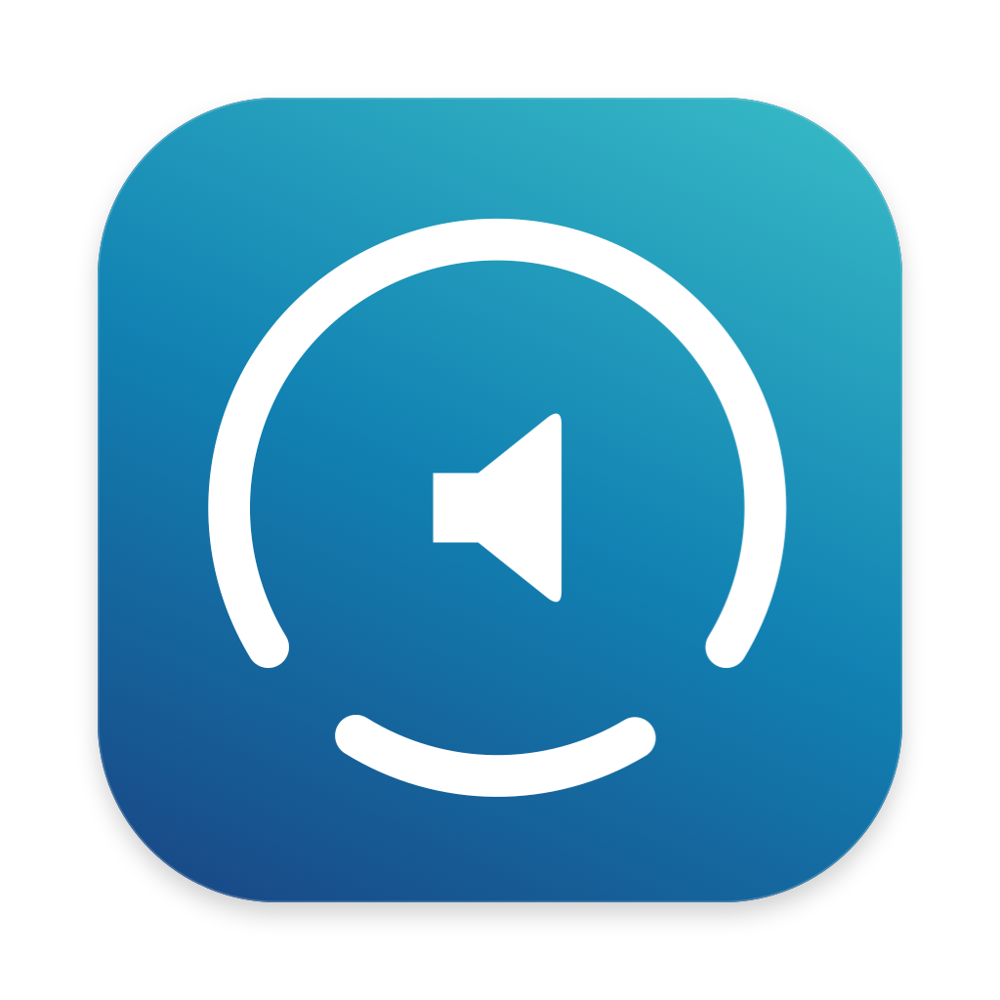
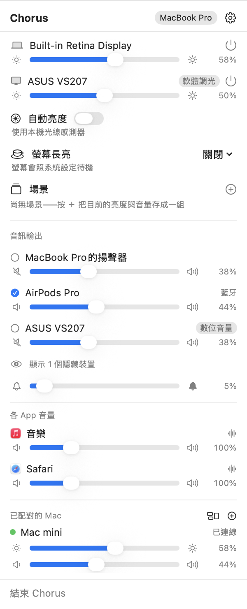
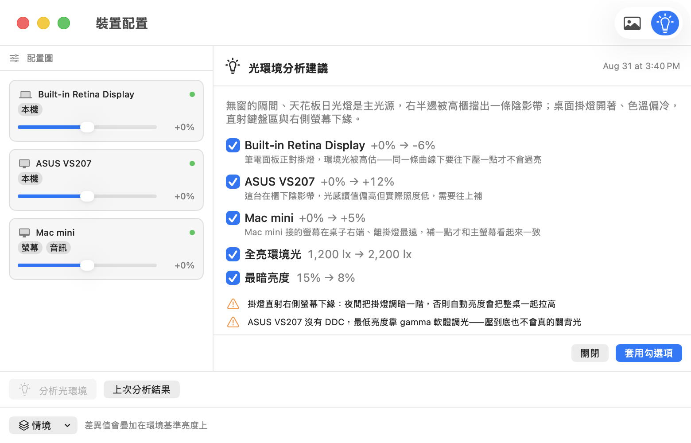
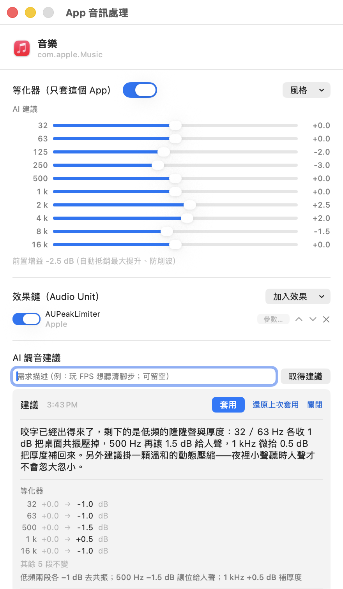
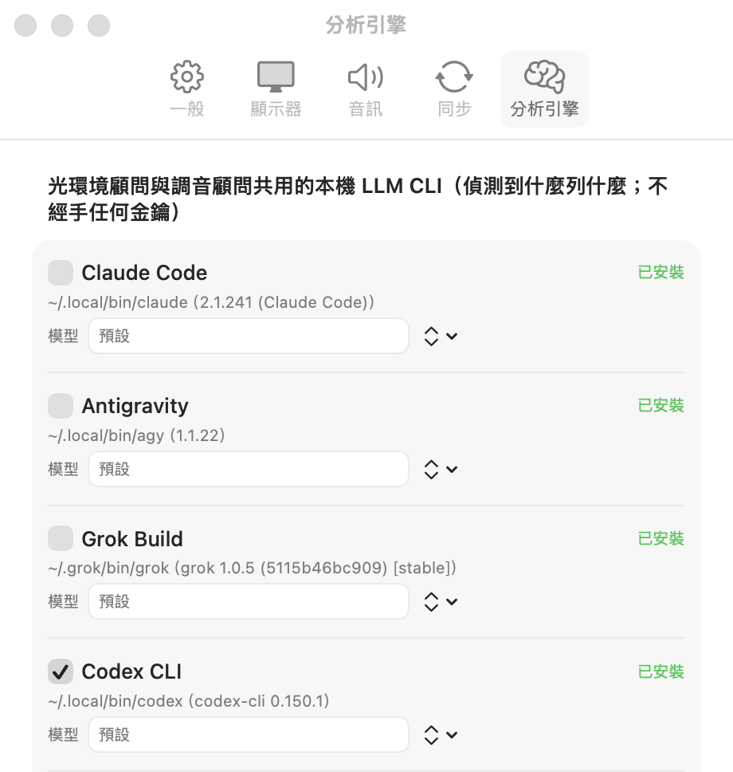

# Chorus



[繁體中文](README.md) | [English](README.en.md)

Chorus 把螢幕亮度與 per-app 音訊收進同一個選單列，再在同一區網讓多台 Mac
即時同步、互相遙控。兩位 AI 顧問：一位看桌面照片給調光策略，一位依文字目標
推薦 EQ 與 AU 效果；都走你本機已登入的 AI CLI，Chorus 不經手任何 API key。

> **一個 App，對上 Lunar 級亮度加上 SoundSource 級逐 App 音訊；對等同步不經雲端、
> 不需帳號；AI 調光與調音只用你已有的訂閱。**

`1.5.1`（build 88）· macOS 26+ · Apple Silicon · 繁體中文／简体中文／English



*選單列：本機的螢幕、音訊裝置與各 App 音量，最下面是同一張桌上的另一台 Mac：
亮度與音量在兩台之間即時同步，也可以直接從這裡拉它的滑桿。*


**App 與選單列共用同一個標誌，圖示本身就是狀態**：外環（開口朝下的 280° 量表）
是主顯示器亮度，中央沿用系統聲音選單的圖示語彙畫出目前的預設輸出裝置：
內建喇叭畫那台 Mac、HDMI／DisplayPort 畫螢幕、AirPods 畫 AirPods、AirPlay 畫 AirPlay，
靜音時符號上加斜線；一般喇叭、USB 與虛擬裝置維持手繪喇叭，兩道聲波隨音量逐段亮起，
靜音時改為叉號。
底部短橫亮起代表螢幕長亮，雙點代表專注倒數；未啟用時短橫淡化。
右側顯示較早到期的螢幕長亮／專注倒數，底部標記對應該倒數的種類；
沒有倒數但螢幕長亮仍生效時顯示 ∞，其餘時候只顯示圖示。

App icon 使用藍綠漸層底色與白色標誌；選單列使用系統自動反白的單色版本。
執行 `scripts/render-icons.sh` 可從選單列繪圖程式重新產生 `.icns`、PNG 與
[深淺底色及狀態預覽](assets/icon-design.png)。

---

## ① 一組 Mac，當成一台用

在任一台調亮度或音量，配對的機器同一瞬間跟上；也可以只針對某一台下指令。
無雲端、無帳號。同一區網自動找到彼此，一次性 PIN 確認後走端對端加密。

- **配對**：同一區網自動發現，用一次性 PIN 確認就完成。之後走端對端加密連線，
  沒配對過的機器一律拒絕。無雲端、無帳號，2–5 台實測。
- **會同步的**：螢幕亮度、輸出音量與靜音（兩者各有獨立開關）、環境光讀值。
  兩台同時調也不會打架。
- **只遙控、不同步的**：螢幕電源、輸入源、對比、防睡眠、逐 App 音量與靜音：
  這些是「動作」而不是該兩台一致的狀態。選單列可以直接展開任一台的螢幕與音訊裝置，
  「把桌子另一頭那台的螢幕關掉」不必走過去。
- **跨機環境光**：有光線感測器的 Mac 當基準，沒有的跟著它走。Mac mini 這種沒光感的
  機器也能有自動亮度。基準來源斷線會自動接手，闔上筆電不會讓螢幕忽明忽暗。
- **時間排程兜底**：一顆感器都沒有時（Mac mini 單機、筆電合蓋且 peer 全離線），
  可以依日夜時段估一個環境光：白天多亮、晚上多亮、幾點天亮天黑，前後各半小時
  平滑過渡。天亮天黑可以改成依所在地的日出日落自動算，一有真感器回報就立刻讓位。

```bash
chorus set --peer "Mac mini" --all-displays --power off
chorus set --peer "Mac mini" --app com.spotify.client --mute on
```

---

## ② 拍一張桌面，拿到可套用的調光策略

拍一張桌面佈置的照片，讓模型看懂你的光環境，回一份可逐項套用的調光建議。

1. 在**裝置配置圖**視窗匯入桌面照片，把螢幕節點拖到照片上對應的位置。
2. 按「分析光環境」。連同照片送出的還有每台螢幕現在的設定與近期的環境光讀值。
3. 回來的是一份建議清單：**每台螢幕的亮度差異值**、環境光曲線的兩個參數，
   外加不能自動處理的警告，每一項都附一句理由。
4. **逐項勾選才套用**，套用後可一鍵還原。最近 5 次分析留著可回看。



*建議逐項可勾選：每台顯示器的差異值、曲線參數，加上不能自動套用的警告。
已配對的 Mac 也是分析對象之一（上圖第三項）。截圖中的建議內容是示範資料，
不是某次真實模型輸出。*

---

## ③ 一句話目標，拿到 EQ 與 AU 建議

同一套流程搬到音訊側。選一個目標（某個 App 或某台輸出裝置），用一句話說你要什麼：

> 「玩 FPS 想聽清腳步」「Podcast 人聲清楚一點」

- 送出的只有文字：目標是誰、你的需求、**本機實際掃描到的 AU 清單**，以及現在的
  等化與效果鏈。**不送任何音訊內容。**
- 模型只能從那份清單裡挑外掛，挑不在清單裡的會被丟掉，不會冒出你機器上沒有的東西。
- 結果卡逐段列出「現在 → 建議」與理由，**不會自動生效**；按「套用」才寫入，可還原。



*一個 App 一個視窗：等化器（只套這個 App）、AU 效果鏈，最下面是建議卡：
逐段列出「現在 → 建議」，按下「套用」才會生效。建議內容同樣是示範資料。*

### AI 引擎：零金鑰，用你自己的訂閱

兩位顧問與介面翻譯共用一組引擎。Chorus **不經手任何 API key**。它呼叫你本機
已經登入的 AI CLI，計費走你既有的訂閱。偵測到哪幾家就在設定頁列哪幾家：

| CLI | 顯示名稱 |
|---|---|
| `claude` | Claude Code（預設） |
| `agy` | Antigravity |
| `grok` | Grok Build |
| `codex` | Codex CLI |
| `opencode` | OpenCode |
| `pi` | Pi |



分析是**顯式動作**（按鈕觸發，首次有確認對話框），不在背景送任何東西。

---

## 介面語言：內建三種，其他語言你自己翻

Chorus 內建**繁體中文、简体中文與英文**，預設跟著系統語言走，也可以在
設定 → 一般 → 介面語言直接指定其中一種（重新啟動後生效）。系統是別的語言時，
同一個選單可以把**全部介面文字交給同一組 AI CLI 翻譯**：

- 來源是內建的英文那份（含複數形），送出去的只有 Chorus 自己的介面字串，
  沒有你的任何資料；40 條一批，通常幾分鐘跑完，每批即時落地，中途取消不白做。
- 翻好的檔只存在這台 Mac（`~/Library/Application Support/Chorus/UITranslations/`），
  重新啟動後生效。選單裡**三種內建語言永遠在最上面**，隨時切回去，翻譯檔不會被刪。
- 每個 format specifier 都會逐條驗證，翻壞的那幾條自動退回英文而不是顯示錯亂。
  App 升版多出來的字串在補翻前顯示英文，設定頁會提示「補翻 N 條新字串」。

這是機器翻譯，介面上明講。內建那三份不走這條路，是隨 App 一起簽章發行的。

---

## 等化器與效果鏈

- **等化器**：每台輸出裝置、每個 App 各一組。手動 10 段、**21 條風格 preset**，
  或 [AutoEq](https://github.com/jaakkopasanen/AutoEq) 耳機校正（內建常見型號、
  也可貼上校正檔）。抬高頻段時自動配上前置衰減，不會破音。
- **AU 效果**：掛上 Audio Unit 效果，per-app 與裝置層各一條鏈，參數面板即時可聽。
  **只支援 macOS 內建的 Apple 效果**（AUDynamicsProcessor、AUMatrixReverb
  等二十餘個）；第三方外掛不在支援範圍內，不會出現在清單裡。
- 外掛在載入時把 App 帶掛的話，下次啟動會被標成**已隔離**、不再自動載入：
  最壞只崩一次，不會每次開機都崩。

---

## 其餘功能

### 顯示

- **亮度**：外接螢幕走 DDC/CI 直接調背光；內建面板與 Apple 顯示器走系統路徑；
  螢幕不支援 DDC 時自動改用軟體調光。滑桿下段 25% 也走軟體調光：外接螢幕的
  硬體最低亮度常常還是太亮，夜裡可以再往下壓。
- **自動亮度**：跟著環境光走，曲線的最暗亮度與全亮環境光可調，每台螢幕可各給
  一個差異值，也可以逐台退出。
- **螢幕電源**：一顆電源鈕，內建面板與外接螢幕都能真的關掉（依螢幕能力自動選路徑）。
- **輸入源切換**、**對比**、**防睡眠**（30 分鐘／1 小時／無限期／接著某台螢幕／
  某個 App 執行時／有 agent 工作或高負載時：綁定的螢幕拔掉或 App 關掉就自動失效，接回來、再打開會自己恢復）。
- **有 agent 工作或高負載時**：AI agent 在工作**或**整機 CPU／GPU／網路達門檻時防睡眠，
  兩邊都放開後才解除。Agent 看 Claude Code／Codex session log 修改時間（不讀內容）
  與其餘來源；行程在不等於在工作，停在 prompt 的不算。這一檔固定擋螢幕與系統待機。
- **闔蓋防睡（上述合併模式，預設關閉）**：
  在合併模式下，有工作中的 **agent 來源**時即使闔上筆電螢幕也保持清醒（純高負載不觸發闔蓋防睡）。
  - **安全與硬體限制**：
    - **預設關閉**（需手動在設定開啟）。
    - **硬體支援**：僅支援具備內建螢幕蓋的 MacBook 機型；無蓋機種（如 Mac mini、Mac Studio、Mac Pro）不支援且會自動隱藏／禁止啟用此功能。
    - **電量底線**：使用電池時，電量低於 30%（可設定 30%–50%，底線至少 30%）立即解除防睡眠；電量讀取失敗時亦保守解除。
    - **溫度保護**：系統熱壓力達「嚴重」（`.serious`）或更高時立即解除，避免闔蓋高溫損害硬體。**闔蓋防睡期間切勿將 MacBook 放入包包或密閉空間！**
    - **闔蓋時限**：單次闔蓋最長保持 3 小時（即使接上 AC 電源也同樣套用 3 小時上限）；達時限後自動解除並鎖定，直至重新開蓋才重置計時。
  - **特權輔助程序（Helper）**：
    此功能依賴以 root 權限執行的特權輔助程序（`ChorusPowerHelper`，透過 `SMAppService.daemon` 註冊）。
    - **安裝與允許**：在設定頁開啟開關時會彈出確認說明，確認後向系統註冊，並需前往「系統設定 › 一般 › 登入項目與延伸功能」允許一次。
    - **移除**：可在設定頁進階選項中「移除輔助程序」，Chorus 會先安全釋放持有並確認系統狀態後再註銷。
    - **自動還原**：正常情況下，當所有工作來源結束、連線中斷（App 退出或當機）、60 秒心跳逾時或系統重新開機時，輔助程序會自動將系統睡眠設定還原；但若**輔助程序本身當機或異常崩潰**，系統睡眠設定可能殘留，需依下方疑難排解手動執行指令還原。
- **高負載門檻**：合併模式內的負載側——整機 CPU／GPU／網路任一項持續達門檻（預設 15 秒）
  才算 busy，低於維持門檻滿 120 秒後放開（agent 寬限另計）。門檻可在設定調整；
  GPU 不可讀時明確降級，CPU／網路仍可用。
- **緊急復原**：3 秒內連按 8 次 ⌘ 把所有關掉的螢幕接回來，不會把自己鎖在黑屏裡。
- **媒體鍵接管**：只在 macOS 原生處理不了時接手（螢幕喇叭的音量鍵、沒有內建螢幕
  機器的亮度鍵），其餘按鍵維持原生行為。

### 音訊

- **裝置**：音量／靜音／預設裝置切換、左右平衡、裝置優先順序（偏好的耳機一接上
  就成為預設並還原上次音量）、提示音音量與輸出音量分開。
- **逐 App**（**預設關閉**，開啟時需要系統音訊錄製權限）：各 App 獨立音量
  （最高 400%）、靜音與輸出路由，設定記在 App 上、重開自動恢復。
  可以把某些 App 放進**排除清單**，Chorus 完全不碰它們。
  沒調整過的 App 走原生路徑，不經過 Chorus。
- **虛擬輸出裝置**（設定頁一鍵安裝）：DP/HDMI 螢幕喇叭沒有系統音量，macOS 會停用
  音量鍵與控制中心。把虛擬裝置設為預設輸出後，音量 UI 全部恢復；支援 DDC 的螢幕
  直接調硬體音量（不損音質），其餘用軟體衰減。
- 沒給權限時，逐 App 與等化整組隱藏；裝置音量、亮度、同步完全不受影響。

### 設定備份與診斷

- **iCloud Drive 備份**（預設關閉）：設定、場景、EQ 與效果鏈寫成一份純文字 JSON
  放進你自己的 iCloud Drive，每台機器各一份、只寫不讀。換機時從設定頁挑一台匯入；
  綁機器硬體的項目（配對金鑰、裝置 UID）會自動跳過。不經過任何我們的伺服器。
- **診斷紀錄**：`~/Library/Logs/Chorus/chorus.log`（2 MB 一輪、留三輪）。裝置插拔、
  預設輸出切換、場景套用與還原、App 音訊接管的每一步都記在這裡。聲音或畫面突然
  不對時，把這個檔連同發生時間一起回報就能定位。設定頁有「在 Finder 顯示」。

### 命令列與自動化

`chorus` CLI 內嵌在 App 裡，設定頁一鍵安裝到 `/usr/local/bin`（不需要管理員密碼）；
用 Homebrew 安裝的話已經連到 PATH，不用再按。
同一套語意也開在 localhost HTTP 上（預設關閉，設定頁開啟，只綁 `127.0.0.1` 並要 token）。

```bash
chorus set --brightness 50%
chorus set --display-like DELL --brightness +10%
chorus set --app com.apple.Music --volume 40%
chorus scene 電影
chorus scene 工作 --for 25m # 限時場景：時間到自動還原
chorus scene --end          # 提前結束並還原
chorus listen | jq          # 狀態變動的事件流
chorus doctor               # 檢查權限、探索、各裝置連線與音訊路徑，並列出修復步驟

# 心跳租約（在背景長任務或自訂 agent wrapper 中保持防睡）：
chorus keepawake hold --id my-task --ttl 600   # 取得或續訂租約（預設 600 秒，範圍 30–3600 秒）
chorus keepawake status                        # 查詢當前防睡與租約狀態
chorus keepawake release --id my-task          # 任務結束時釋放租約
```

**心跳租約包裝腳本範例（wrapper 心跳迴圈）**：
```bash
# 長時間執行的背景任務 wrapper 範例
LEASE_ID="backup-job-$$"
TTL=600

# 啟動背景心跳（每 ttl/3 秒續約一次）
(
  while true; do
    chorus keepawake hold --id "$LEASE_ID" --ttl "$TTL" >/dev/null 2>&1
    sleep 200
  done
) &
HEARTBEAT_PID=$!

cleanup() {
  kill "$HEARTBEAT_PID" 2>/dev/null
  chorus keepawake release --id "$LEASE_ID" >/dev/null 2>&1
}
trap cleanup EXIT INT TERM

# 執行實際工作任務
./run-heavy-task.sh
```

**場景**：一組具名的動作（「電影」＝全部螢幕 30% ＋ 輸出音量 20%）。
選單列、`chorus scene <名稱>` 與 HTTP 觸發的是同一份。

**限時場景**（`--for`）：套用前先記住這個場景會動到的每一個值，時間到
自動放回去；提前結束與結束 Chorus 走同一條還原路。涵蓋範圍由場景內容
決定，所以「只還原我們動過的」。這 25 分鐘內你手動調的其他東西不會被
碰。輸入源切換讀不回原值（動作型 VCP），會誠實列在「不會自動還原」裡。

---

## 疑難排解：闔蓋防睡殘留（Lid-Closed Keep-Awake Leftover）

當啟用闔蓋防睡時，輔助程序會以 root 身分修改 macOS 系統電源設定（`pmset -a disablesleep 1`）。正常情形下，結束 App、連線中斷、心跳逾時或重新開機時，輔助程序皆會自動將睡眠設定還原。但**若輔助程序異常當機（crash）、權限被系統中途撤銷或發生未預期狀況，系統可能會殘留「禁止睡眠」狀態**，此時必須由使用者手動執行指令還原：

1. **檢查系統是否處於防睡眠狀態**：
   ```bash
   pmset -g | grep SleepDisabled
   ```
   若輸出包含 `SleepDisabled 1`，表示系統全域睡眠目前被停用。

2. **手動還原系統睡眠**：
   ```bash
   sudo pmset -a disablesleep 0
   ```
   執行後系統將立即恢復 macOS 原生的睡眠行為。您也可以在 Chorus 設定頁或選單列中查看輔助程序狀態，若提示自身殘留，可直接按「還原」按鈕嘗試自動解除。

---

## 安裝

用 [Homebrew](https://brew.sh)：

```bash
brew install gixiphy/tap/chorus     # 裝 Chorus.app 與 chorus CLI
brew upgrade --cask chorus           # 之後更新
```

或到 [Releases](https://github.com/gixiphy/Chorus/releases) 下載 zip，解壓後把
`Chorus.app` 拖進「應用程式」。

虛擬音訊裝置（HAL driver）兩種方式都不會自動裝。開啟 Chorus 後到設定頁按「安裝驅動」
（需管理員密碼）。`brew uninstall --cask chorus` 會連 driver 一起移除。

**上不了 Mac App Store**：亮度與螢幕電源用到 private API，也必須關掉 sandbox，
所以以 Developer ID 簽章＋Apple 公證直接發行。

自行建置：

```bash
xcodegen generate        # 產生 Chorus.xcodeproj（.xcodeproj 不進版控）
open Chorus.xcodeproj
```

`./scripts/package.sh` 會遞增 build 號、跑 Release archive、以 Developer ID 重簽、驗簽並產出 zip；
本機存好 notarytool 憑證（`xcrun notarytool store-credentials chorus …`）的話會一併送公證、staple
並驗過 Gatekeeper，任何一關沒過就中止，不會產出半成品。

Keychain 裡有多張同名的 Developer ID Application 憑證（例如舊的還沒刪、新的剛續期）時，
腳本會停下來要你指定用哪一張。`security find-identity -v -p codesigning` 取指紋後：

```bash
CHORUS_SIGN_IDENTITY=<40 字元 SHA-1 指紋> ./scripts/package.sh
```

發版：`./scripts/release.sh --package --version 1.12.0` 一路做完打包、公證、git tag、
GitHub Release（上傳 zip）、更新 [Homebrew tap](https://github.com/gixiphy/homebrew-tap) 的 cask
（version 與 sha256），最後 `brew fetch` 驗證。已有 zip 時省略 `--package`；`--dry-run` 只印指令。

純邏輯集中在 `Packages/ChorusCore`，`cd Packages/ChorusCore && swift test` 不碰硬體就跑得完。

### 異常結束回報

Chorus 不會把任何東西送出這台 Mac。crash / hang 的證據留在 `~/Library/Logs/Chorus/diagnostics/`
（MetricKit 診斷 + 系統 `.ips` 摘要，最多 20 份），設定 ▸ 診斷 ▸「匯出診斷包…」打成一個 zip 附到 issue。
`scripts/package.sh` 會把每版的 dSYM 存到 `dist/dsyms/`，收到回報後：

```bash
python3 scripts/symbolicate-diagnostics.py <診斷包解開的 diagnostics/xxx-crash.json> --dsym dist/dsyms/Chorus-<版本>-b<build>.dSYMs.zip
```

## 已知事項

- **區域網路權限**（macOS 15+）：被拒時同步會靜靜失效。若系統設定的清單裡沒有
  Chorus，重新開機通常可修復（已知的 macOS 問題）。選單列會顯示疑難排解提示。
- M1 世代 Mac mini 的內建 HDMI 埠沒有 DDC；部分 USB-C→HDMI 轉接器也不透傳；
  這些情況會自動改用軟體調光。
- AU 外掛在播放途中崩潰擋不住（業界現狀），隔離機制只保證不會每次啟動都崩。
- 虛擬輸出裝置在「鏡射螢幕硬體音量」模式下，左右平衡不生效（介面上有提示）。

## 授權

- `Chorus/Display/Vendor/AppleSiliconDDC.swift` vendored 自
  [waydabber/AppleSiliconDDC](https://github.com/waydabber/AppleSiliconDDC)（MIT）。
- 等化器的耳機校正資料來自 [AutoEq](https://github.com/jaakkopasanen/AutoEq)（MIT）；
  biquad 係數公式取自公開的 Audio EQ Cookbook（Robert Bristow-Johnson）。
  風格 preset 的曲線為自行編寫。
- `AudioDriver/` 底本為
  [proxy-audio-device](https://github.com/briankendall/proxy-audio-device)（Unlicense）。
